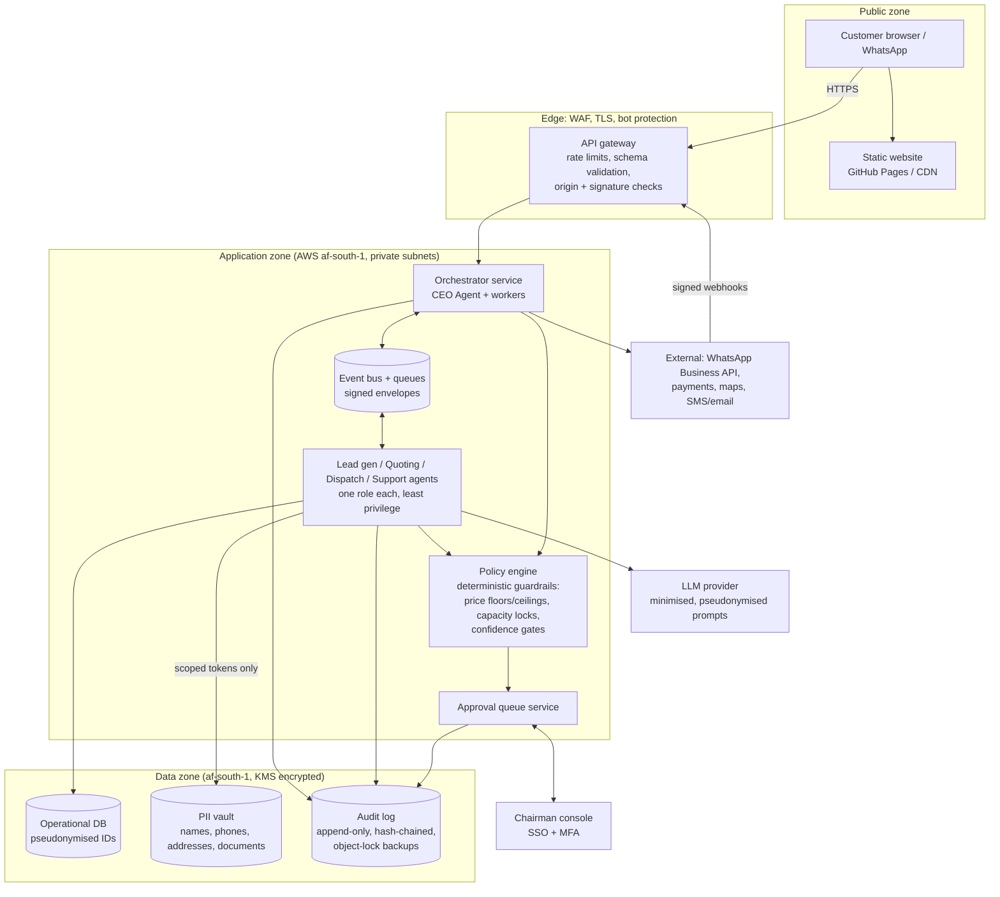

# 2. System and security architecture

Goals, in priority order: security, maintainability, architectural simplicity, human-centred design.
Principle: **the LLM agents propose, deterministic code enforces, a human approves anything that matters.**

## Diagram

## Components and decisions

| Area | Decision | Why |
| --- | --- | --- |
| Hosting region | AWS `af-south-1` (Cape Town) for compute and all PII | Keeps personal information in South Africa and avoids cross-border transfer questions (POPIA section 72). Matches your AWS experience. |
| Website | Static prerendered site (this repo), no secrets, no server | Smallest attack surface; all `VITE_*` values are public. |
| API gateway | One public entry: WAF, per-IP and per-key rate limits, request size caps, JSON-schema validation, CORS to the site origin only, bot challenge on the quote endpoint | Zero trust at the edge; nothing reaches the orchestrator unvalidated. |
| Webhooks | Verify provider signatures (WhatsApp `X-Hub-Signature-256`, payment provider signature), replay window, idempotency keys | Inbound third-party calls are untrusted until proven. |
| Agent-to-agent messaging | Events on a bus (SQS/EventBridge style). Each message is an envelope with `id`, `type`, `correlationId`, `actor`, `schemaVersion`, `payload` and a signature (HMAC or JWT) from the sending service identity | Auditable, replayable, and an agent cannot impersonate another. |
| Service identity | Each agent runs under its own IAM role and can only read the topics and tables it needs. No shared credentials. | Least privilege; a compromised or confused agent has a small blast radius. |
| Guardrails | A policy engine in ordinary code, outside any prompt: price floors/ceilings, capacity locks, confidence gates, spend and payout limits, allow-lists of tools per agent | Prompts can be talked around; code cannot. The same pure pricing module the website uses is reused here. |
| Approval queue | First-class service and table. Agents can only *request* approval. Only an authenticated human decision moves an item to approved. | Implements the Chairman / human-in-the-loop model. |
| Operational DB | PostgreSQL, references customers by pseudonymous ID | Agents work on jobs without needing personal details. |
| PII vault | Separate store (separate table set or database) for names, phone, email, addresses, ID/driver documents. Field-level encryption with KMS keys, access only via a narrow service that logs every read | POPIA security safeguards; limits who and what ever sees raw PII. |
| Audit log | Append-only events for every agent input summary, decision, tool call, approval and data transformation. Hash-chained records, daily export to write-once storage | Tamper-evident trail for disputes, POPIA accountability and debugging. |
| LLM use | Send the minimum: pseudonymous IDs and the fields needed for the task, never ID numbers or documents. Treat all customer text as untrusted data (prompt-injection). Use a provider under an operator agreement and confirm where it processes data | Reduces both privacy exposure and injection risk. |
| Human access | Chairman console behind SSO and MFA, role-based, session-limited | The approval queue is the highest-value target. |
| Secrets | Secrets manager, no secrets in the repo or in CI variables that ship to the browser | Only `VITE_*` public values are in GitHub variables. |
| CI/CD | GitHub Actions: typecheck, tests, build; dependency and secret scanning; protected `main`; OIDC to AWS for deploys (no long-lived keys) | Maintainable and safe by default. |

## Zero-trust request path (quote request)

1. Browser posts to the gateway. WAF, rate limit, size cap, bot check, origin check, schema validation.
2. Gateway forwards a validated request with an idempotency key to the orchestrator. Duplicate keys return the first result.
3. PII (name, phone, email, addresses) is written to the vault, and the rest to the operational DB under a new pseudonymous ID.
4. A `quote.requested` event goes on the bus. The Quoting agent prices it using the shared deterministic engine, optionally enriched by a maps lookup for distance and tolls.
5. The policy engine decides: within limits and confident, the quote is *prepared*. Otherwise it is flagged `needs_review`.
6. Customer-facing messages and final bookings always become approval items. The Chairman approves or edits. Every step writes an audit event.

## POPIA mapping (the 8 conditions)

| Condition | How the design addresses it |
| --- | --- |
| Accountability | Named Information Officer, registered with the Information Regulator; audit log and approval trail. |
| Processing limitation | Collect only what a quote and move need; explicit consent captured with notice version and timestamp; no ID numbers through the website. |
| Purpose specification | Purposes listed in the privacy notice and tied to data fields; retention schedule per data class. |
| Further processing limitation | Marketing use needs separate consent. Agents may not reuse data for new purposes. |
| Information quality | Customer can correct details; server re-validates all input. |
| Openness | Privacy notice on the site; documentation of processing operations. |
| Security safeguards | Encryption at rest and in transit, vault separation, least-privilege IAM, MFA, logging, breach-response runbook (notify the Regulator and affected people as POPIA requires). |
| Data subject participation | Process for access, correction and deletion requests, with the vault as the single place to act. |

Also needed: operator agreements with every processor (cloud, messaging, payments, LLM), a retention and deletion job,
and a breach-response plan. **Have a South African privacy lawyer review this before launch.**

## Failure modes to design for

- **Prompt injection through customer text or WhatsApp messages**: treated as data, never as instructions; tools are allow-listed per agent; policy engine and approvals sit downstream.
- **Runaway pricing or discounting**: floors/ceilings and per-day discount budgets in the policy engine.
- **Double booking**: capacity locks per vehicle, driver and date, taken transactionally at approval time.
- **Agent outage or low confidence**: automatic hand-off to the Chairman queue; the site's WhatsApp/email fallback keeps working.
- **Data breach**: vault isolation, field-level encryption and access logging limit what can leak and let you prove what was touched.
