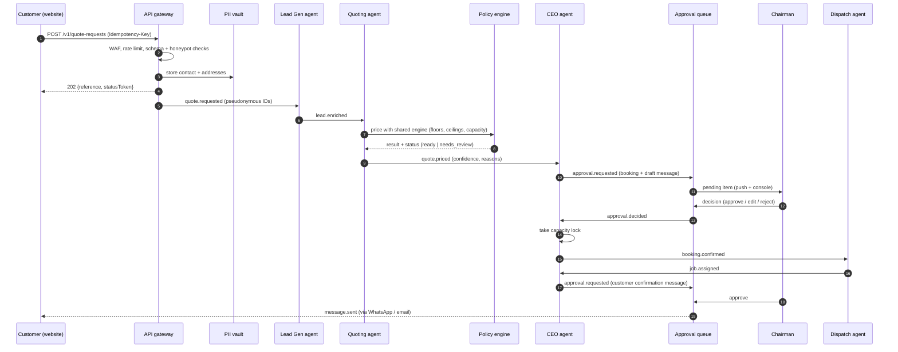

# 5. API schema and event flow

- HTTP contract: [`api/openapi.yaml`](api/openapi.yaml) (OpenAPI 3.1). The `QuoteRequestV1` schema mirrors the
  TypeScript type in `src/lib/api.ts`. Keep them in sync (generate the TS type from the YAML in CI when the
  backend exists).
- This page covers the **event flow** inside the orchestrator and how frontend input reaches it.

## Surfaces

| Endpoint | Caller | Purpose |
| --- | --- | --- |
| `POST /v1/quote-requests` | Website | Submit a quote request. Returns `202` with a reference and status token. |
| `GET /v1/quote-requests/{reference}/status` | Website / link | Tokenised, no-PII job status for the customer. |
| `POST /v1/webhooks/whatsapp` | WhatsApp provider | Inbound messages. Signature verified. |
| `POST /v1/webhooks/payments` | Payment provider | Deposit paid, failed, refunded. Signature verified and re-queried. |
| `GET /v1/admin/approvals`, `POST .../{id}/decision` | Chairman console | The human-in-the-loop queue. |
| `GET /v1/admin/audit-events` | Chairman console | Read-only audit trail. |
| `POST /v1/admin/agents/{agent}/pause` | Chairman console | Kill switch. |

## Event catalogue

All bus messages use the `EventEnvelope` schema (`id`, `type`, `schemaVersion`, `correlationId`, `causationId`,
`actor`, `occurredAt`, `payload`, `signature`). One `correlationId` follows a customer request from first contact to
completion, so the audit log reads as a story.

| Event | Emitted by | Consumed by | Notes |
| --- | --- | --- | --- |
| `quote.requested` | Gateway | Lead Gen, CEO | Payload holds pseudonymous IDs, not PII. |
| `lead.enriched` | Lead Gen | Quoting | Access constraints, inventory and dates normalised; missing items listed. |
| `quote.priced` | Quoting | CEO | Lines, tiers, confidence, guardrail results from the shared pricing engine. |
| `approval.requested` | CEO | Approval queue | Booking, discount, message, payout, config. |
| `approval.decided` | Approval queue | CEO, originator | Includes edits and the approver. |
| `message.drafted` | Any agent | CEO | Customer-facing text. Sending requires an approval. |
| `message.sent` | Messaging service | CEO, Support | Only after `approval.decided = approved`. |
| `booking.confirmed` | CEO | Dispatch, Support | Capacity lock taken. |
| `payment.deposit_paid` | Payment webhook handler | CEO | After provider re-query. |
| `job.assigned` | Dispatch | CEO, Support | Vehicle, driver, crew. |
| `job.status_changed` | Dispatch / driver app | Support | Drives the customer status page. |
| `job.completed` | Dispatch | CEO, Support | Triggers rating request and payout preparation. |
| `payout.requested` | CEO | Approval queue | Financial action, always human-approved. |
| `claim.opened` | Support | CEO | Auto human takeover for any claim or dispute. |
| `guardrail.tripped` | Policy engine | CEO | Floor, ceiling, capacity, confidence, rate limits. |
| `security.suspected_injection` | Any agent | CEO | Message quarantined for review. |
| `agent.health` | Each agent | CEO | Heartbeat and error counts for the daily report. |

## Main flow: website to confirmed job

## Rules that apply to every flow

- **Idempotency:** every mutating call carries an `Idempotency-Key`; replays return the first result.
- **Ordering and replay:** consumers are idempotent and ignore events they have already applied (`id` de-duplication).
- **Failure:** events that fail repeatedly go to a dead-letter queue and raise `agent.health` plus a Chairman alert.
- **No PII on the bus:** payloads carry pseudonymous IDs; services that truly need contact data fetch it from the vault with a narrowly scoped, logged call.
- **Versioning:** `schemaVersion` on every request and event. Additive changes only within a major version.
- **Webhooks:** respond fast with `200`, verify signatures on the raw body, enforce a replay window, process asynchronously.
- **Rate limits:** public endpoints are limited per IP and per token, with `429` plus `Retry-After`.
